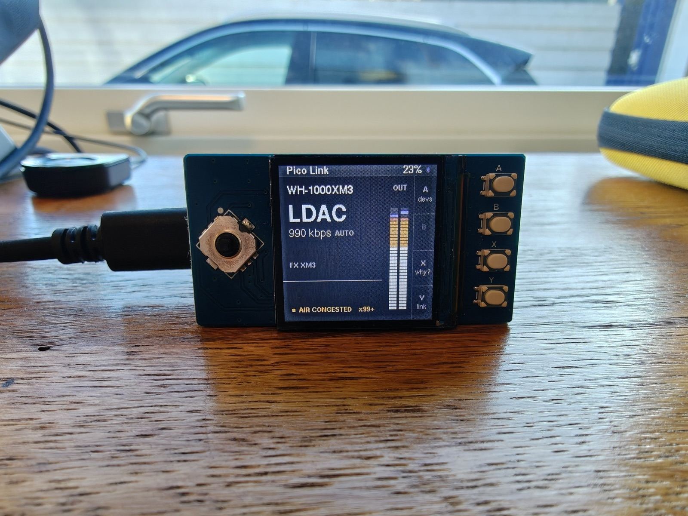
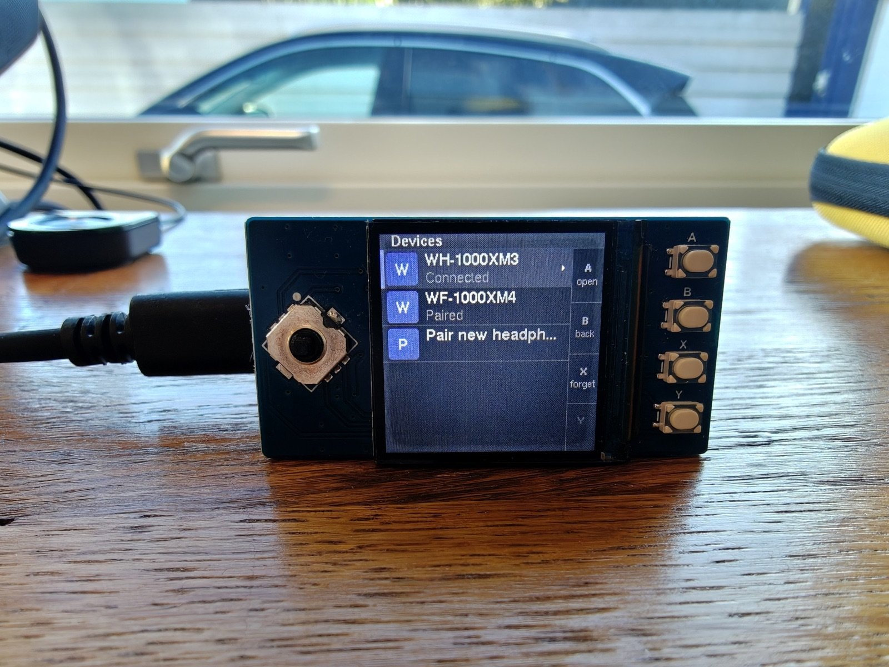
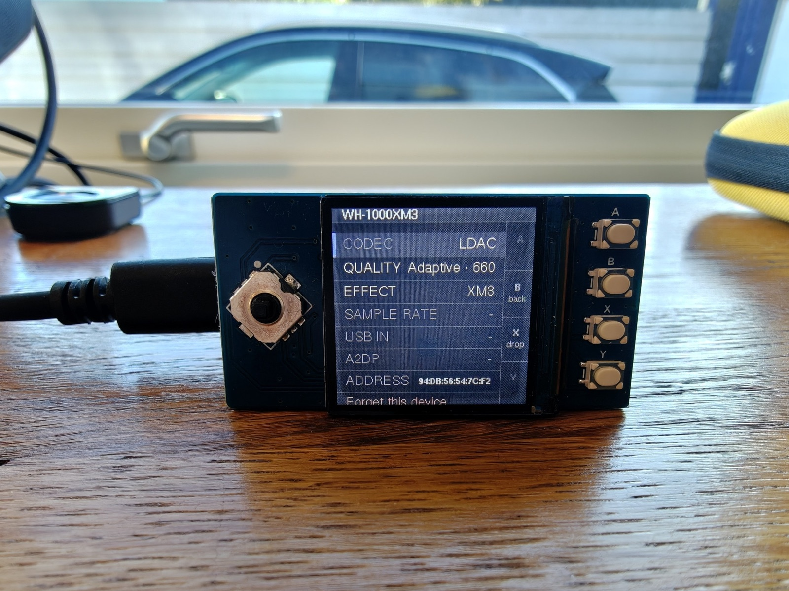
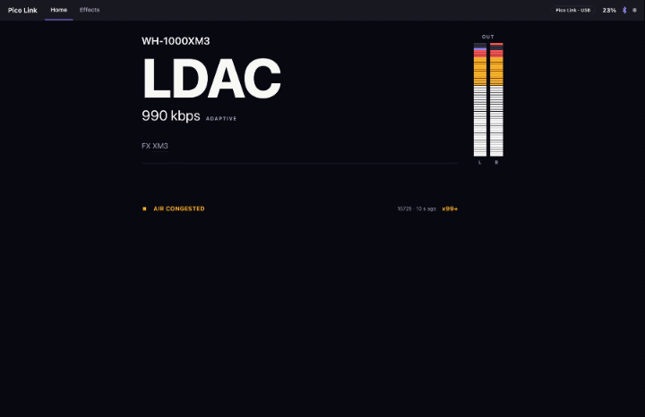
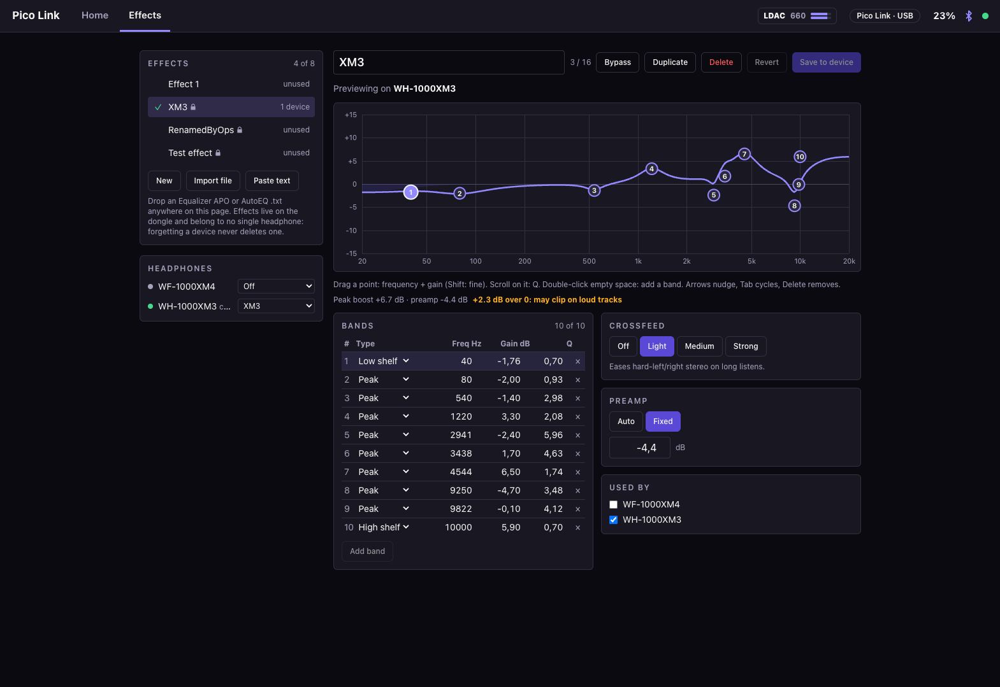

# Pico Link

**A USB-to-Bluetooth audio dongle with a screen.**

Plug it into a computer and it shows up as a plain USB sound card — no driver,
no app. Pico Link streams that audio to your Bluetooth headphones in **LDAC at
up to 990 kbps**, and shows you exactly what the link is doing while it does it.



Other dongles are blind: one button, one LED, and a guess about which codec you
actually got. Pico Link has a 240x240 screen and a d-pad, so pairing, switching
headphones, picking quality and watching the live link all happen on the device.

## What it does

- **Driverless USB audio in.** Standard USB Audio Class device; the host just
  sees a sound card.
- **LDAC out, with SBC fallback.** Adaptive bitrate steps down when the air gets
  crowded instead of stuttering, or lock it to a fixed quality.
- **The link, on screen.** Codec, live bitrate, a stereo output meter, headphone
  volume, and a status strip that tells you *why* when something degrades
  (`AIR CONGESTED`, not just a crackle).
- **Headphones managed on the device.** Pair new ones, switch between paired
  ones, forget old ones — all from the buttons. Pairings survive a power cycle.
- **Per-headphone EQ.** Up to 10-band parametric EQ, crossfeed and preamp,
  processed on the dongle. Effects are presets you assign to headphones, so
  forgetting a pair never loses your tuning. Import straight from AutoEQ or
  Equalizer APO.
- **A web companion, no install.** Open
  [picolink.coroiu.com](https://picolink.coroiu.com/) in a Chromium browser and
  connect over WebUSB.

<table>
  <tr>
    <td></td>
    <td></td>
  </tr>
  <tr>
    <td align="center"><sub>Pair, switch and forget headphones</sub></td>
    <td align="center"><sub>Per-headphone codec, quality and effect</sub></td>
  </tr>
</table>

## Web companion

The same live view as the device, bigger — plus an EQ editor you drag by hand.
Changes preview live on the connected headphones before you save them to the
dongle.





Drop a `.txt` export from AutoEQ or Equalizer APO onto the page to import it.

### Linux

Needs a udev rule so the browser can claim the device without root:

```sh
sudo cp tools/udev/70-pico-link.rules /etc/udev/rules.d/
sudo udevadm control --reload
sudo udevadm trigger
```

Replug the device, then open the web companion in Chrome or Edge. Linux is
untested on real hardware so far — report back if you try it.

## Hardware

Two off-the-shelf boards. The LCD plugs straight onto the Pico — no soldering.

| Part | |
|------|--|
| [Pimoroni Pico Plus 2 W](https://shop.pimoroni.com/products/pico-plus-2-w) | RP2350B, 8MB PSRAM, 16MB flash, RM2 radio (Bluetooth 5.2 Classic + LE), USB-C |
| [Waveshare Pico-LCD-1.3](https://www.waveshare.com/wiki/Pico-LCD-1.3) | 240x240 IPS, ST7789, SPI, 5-way joystick + 4 buttons |

### Why RP2350

LDAC rides on A2DP, which needs Bluetooth Classic (BR/EDR). That rules out most
hobbyist wireless MCUs: the ESP32-S3 is BLE-only, and the original ESP32 has
BR/EDR but no USB device peripheral, so it can't be a sound card. RP2350 with the
CYW43439 radio has both.

## Status

Working and in daily use: LDAC streaming, adaptive bitrate, on-device pairing
and device management, EQ and crossfeed, and the web companion. No tagged
release yet — build from source, or grab `pico_link.uf2` from the latest
[firmware workflow run](../../actions/workflows/firmware.yml) on `main`.

Hands-free (HFP) is not supported: the CYW43439 can't route SCO audio the way
it would need. Pico Link is a listening device.

## Building

### Firmware

Needs pico-sdk 2.1.1, the Arm GNU toolchain and a Rust toolchain (pinned in
`rust-toolchain.toml`). Apply the vendored SDK patches once, then build:

```sh
export PICO_SDK_PATH=~/.pico-sdk/sdk/2.1.1
tools/apply-sdk-patches.sh
cmake -S firmware -B firmware/build -DCMAKE_BUILD_TYPE=Release
cmake --build firmware/build -j
```

Hold **BOOTSEL** while plugging the board in and copy
`firmware/build/pico_link.uf2` onto the `RP2350` drive.

### Desktop emulator

The UI runs on the desktop too, so it can be developed with no hardware:

```sh
cargo run --bin desktop   # windowed emulator
cargo test
```

### Web companion

```sh
cd web && npm install && npm run dev
```

Runs against a simulated device by default. See [`web/README.md`](web/README.md).

## How it's built

C owns the firmware — pico-sdk, BTstack, TinyUSB, Sony's libldac — with the
LDAC encoder running on the second core. The display and UI are a
platform-free Rust `no_std` crate called over a narrow FFI, which is what lets
the same UI run in the desktop emulator. Architecture decisions live in
`.planning/decisions/`.

## Credits and licence

The audio and radio half draws on
**[USBPods](https://github.com/wasdwasd0105/USBPods-Pico2W)** by wasdwasd0105 —
UAC in, SBC/AAC/LDAC/LHDC out on a Pico 2 W — as a reference for how pico-sdk,
BTstack, TinyUSB and libldac fit together on this hardware.

LDAC encoding uses Sony's Apache-2.0 `libldac`; Bluetooth is BlueKitchen's
BTstack as distributed with the Pico SDK.

Pico Link is licensed under the [PolyForm Noncommercial License 1.0.0](LICENSE.md).
